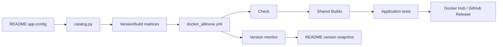

# docker-builder

Github Actions for Docker Image Building. / 使用 GitHub Actions 构建、检测与发布 Docker 镜像。

**Source of truth / 唯一配置源：** This README's `app-config` JSON. The application table is a view, **not** an independent configuration file.

## Navigation / 目录

- [Applications / 应用清单](#applications--应用清单)
- [Workflow / 工作流](#workflow--工作流)
- [Maintenance / 配置维护](#maintenance--配置维护)
- [Machine-readable configuration / Actions 配置](#machine-readable-configuration--actions-配置)
- [Container Version Matrix / 版本探测结果](#container-version-matrix)

## Applications / 应用清单

<!-- app-summary:start -->
**24 applications / 30 build targets** (generated from configuration below).

| Application | Registry repository | Tags | Platforms | Base image | Dockerfiles |
|---|---|---|---|---|---|
| [adguardvpn-cli](application/adguardvpn-cli/) | `grinch27/adguardvpn-cli` | `nightly`, `beta`, `release` | `amd64`, `arm64` | `alpine:latest` | `Dockerfile` |
| [aria2](application/aria2/) | `grinch27/aria2` | `latest` | `amd64`, `arm64` | `alpine:latest` | `Dockerfile` |
| [baidunetdisk](application/baidunetdisk/) | `grinch27/baidunetdisk` | `dev` | `amd64`, `arm64` | `debian:stable-slim` | `Dockerfile` |
| [cloudflare-warp](application/cloudflare-warp/) | `grinch27/cloudflare-warp` | `latest` | `amd64`, `arm64` | `ubuntu:devel` | `Dockerfile` |
| [curl](application/curl/) | `grinch27/curl` | `latest` | `amd64`, `arm64` | `alpine:edge` | `Dockerfile` |
| [dnscrypt-proxy](application/dnscrypt-proxy/) | `grinch27/dnscrypt-proxy` | `latest` | `amd64`, `arm64` | `alpine:edge` | `Dockerfile` |
| [doh-nosni](application/doh-nosni/) | `grinch27/doh-nosni` | `latest` | `amd64`, `arm64` | `debian:sid-slim` | `Dockerfile` |
| [expressvpn](application/expressvpn/) | `grinch27/expressvpn` | `latest` | `amd64`, `arm64`, `386`, `arm/v7` | `debian:stable-slim` | `Dockerfile` |
| [ffmpeg](application/ffmpeg/) | `grinch27/ffmpeg` | `latest` | `amd64` | `ubuntu:devel` | `Dockerfile` |
| [nordvpn](application/nordvpn/) | `grinch27/nordvpn` | `latest` | `amd64`, `arm64` | `debian:stable-slim` | `Dockerfile` |
| [novnc](application/novnc/) | `grinch27/novnc` | `latest` | `amd64`, `arm64` | `debian:stable-slim` | `Dockerfile` |
| [novnc_alpine](application/novnc_alpine/) | `grinch27/novnc` | `latest` | `amd64`, `arm64` | `alpine:latest` | `Dockerfile` |
| [openwrt](application/openwrt/) | `grinch27/openwrt` | `main` | `amd64` | `ubuntu:devel` | `Dockerfile` |
| [privoxy](application/privoxy/) | `grinch27/privoxy` | `latest` | `amd64`, `arm64` | `alpine:latest` | `Dockerfile` |
| [protonvpn](application/protonvpn/) | `grinch27/protonvpn` | `latest` | `amd64` | `debian:stable-slim` | `Dockerfile` |
| [runner](application/runner/) | `grinch27/runner` | `dev`, `slim`, `actions`, `actions-slim` | `amd64` | `debian:testing-slim` | `Dockerfile`, `slim.Dockerfile`, `actions.Dockerfile`, `actions-slim.Dockerfile` |
| [samba](application/samba/) | `grinch27/samba` | `latest`, `alpine` | `amd64`, `arm64` | `debian:testing-slim` + `alpine: alpine:latest` | `Dockerfile`, `alpine.Dockerfile` |
| [sdnext](application/sdnext/) | `grinch27/sdnext` | `latest` | `amd64` | `rocm/dev-ubuntu-24.04` | `Dockerfile` |
| [sdnext-dev](application/sdnext-dev/) | `grinch27/sdnext` | `dev` | `amd64` | `ubuntu:24.04` | `Dockerfile` |
| [squid](application/squid/) | `grinch27/squid` | `latest` | `amd64`, `arm64` | `alpine:latest` | `Dockerfile` |
| [stable-diffusion-webui-amdgpu](application/stable-diffusion-webui-amdgpu/) | `grinch27/stable-diffusion-webui-amdgpu` | `latest` | `amd64` | `rocm/dev-ubuntu-24.04` | `Dockerfile` |
| [steamcmd](application/steamcmd/) | `grinch27/steamcmd` | `dev` | `amd64` | `debian:testing-slim` | `Dockerfile` |
| [ttrss](application/ttrss/) | `grinch27/ttrss` | `latest` | `amd64`, `arm64` | `alpine:latest` | `Dockerfile` |
| [vlmcsd](application/vlmcsd/) | `grinch27/vlmcsd` | `latest` | `amd64`, `arm64`, `386` | `alpine:latest` | `Dockerfile` |
<!-- app-summary:end -->

> **Known conflict / 已知冲突：** `novnc` and `novnc_alpine` both use `grinch27/novnc:latest`. The two directories do not own independent output tags. No tags are changed by this documentation update.

## Workflow / 工作流



`docker_allinone.yml` is the intended authoritative production workflow. Legacy entry points remain for compatibility, and their publishing permissions require separate review.

## Maintenance / 配置维护

| Section | Maintainer | Actions behavior |
|---|---|---|
| `app-config` JSON | Manual review / `catalog.py set` | **Authoritative** app and target settings |
| `app-summary` | Derived from `app-config` | Read-only overview; never parsed as configuration |
| `app-version-table` | Monitor | Displayed upstream version probes; not proof of published images |
| `app-version-json` | Monitor | Stored state used to compare version changes |

Common commands:

```bash
python3 scripts/ci/catalog.py validate
python3 -m unittest discover -s scripts/ci -p 'test_catalog.py' -v
python3 scripts/ci/catalog.py matrix --kind build
python3 scripts/ci/catalog.py get --app samba --tag alpine
python3 scripts/ci/catalog.py set --scope target --app samba --tag alpine --field base_image --value alpine:latest
```

Documentation: [application layout](application/route.md), [workflow consolidation](docs/workflow-consolidation.md).

## Machine-readable configuration / Actions 配置

<details>
<summary><strong>Show canonical application JSON / 展开配置 JSON</strong></summary>

**For Actions:** Preserve the `app-config` markers and fenced JSON exactly. / 请勿修改配置标记或 JSON 格式。

<!-- app-config:start -->
```json
{
  "schema_version": 1,
  "apps": {
    "adguardvpn-cli": {
      "repository": "grinch27/adguardvpn-cli",
      "base_image": "alpine:latest",
      "platforms": [
        "linux/amd64",
        "linux/arm64"
      ],
      "tag_policy": "keep",
      "targets": [
        {
          "tag": "nightly",
          "dockerfile": "Dockerfile",
          "build_arg": "update_channel=nightly"
        },
        {
          "tag": "beta",
          "dockerfile": "Dockerfile",
          "build_arg": "update_channel=beta"
        },
        {
          "tag": "release",
          "dockerfile": "Dockerfile",
          "build_arg": "update_channel=release"
        }
      ]
    },
    "aria2": {
      "repository": "grinch27/aria2",
      "base_image": "alpine:latest",
      "platforms": [
        "linux/amd64",
        "linux/arm64"
      ],
      "tag_policy": "strip_channel",
      "targets": [
        {
          "tag": "latest",
          "dockerfile": "Dockerfile"
        }
      ]
    },
    "baidunetdisk": {
      "repository": "grinch27/baidunetdisk",
      "base_image": "debian:stable-slim",
      "platforms": [
        "linux/amd64",
        "linux/arm64"
      ],
      "tag_policy": "strip_channel",
      "targets": [
        {
          "tag": "dev",
          "dockerfile": "Dockerfile"
        }
      ]
    },
    "cloudflare-warp": {
      "repository": "grinch27/cloudflare-warp",
      "base_image": "ubuntu:devel",
      "platforms": [
        "linux/amd64",
        "linux/arm64"
      ],
      "tag_policy": "strip_channel",
      "targets": [
        {
          "tag": "latest",
          "dockerfile": "Dockerfile"
        }
      ]
    },
    "curl": {
      "repository": "grinch27/curl",
      "base_image": "alpine:edge",
      "platforms": [
        "linux/amd64",
        "linux/arm64"
      ],
      "tag_policy": "keep",
      "targets": [
        {
          "tag": "latest",
          "dockerfile": "Dockerfile"
        }
      ]
    },
    "dnscrypt-proxy": {
      "repository": "grinch27/dnscrypt-proxy",
      "base_image": "alpine:edge",
      "platforms": [
        "linux/amd64",
        "linux/arm64"
      ],
      "tag_policy": "strip_channel",
      "targets": [
        {
          "tag": "latest",
          "dockerfile": "Dockerfile"
        }
      ]
    },
    "doh-nosni": {
      "repository": "grinch27/doh-nosni",
      "base_image": "debian:sid-slim",
      "platforms": [
        "linux/amd64",
        "linux/arm64"
      ],
      "tag_policy": "strip_channel",
      "targets": [
        {
          "tag": "latest",
          "dockerfile": "Dockerfile"
        }
      ]
    },
    "expressvpn": {
      "repository": "grinch27/expressvpn",
      "base_image": "debian:stable-slim",
      "platforms": [
        "linux/amd64",
        "linux/arm64",
        "linux/386",
        "linux/arm/v7"
      ],
      "tag_policy": "strip_channel",
      "targets": [
        {
          "tag": "latest",
          "dockerfile": "Dockerfile"
        }
      ]
    },
    "ffmpeg": {
      "repository": "grinch27/ffmpeg",
      "base_image": "ubuntu:devel",
      "platforms": [
        "linux/amd64"
      ],
      "tag_policy": "none",
      "targets": [
        {
          "tag": "latest",
          "dockerfile": "Dockerfile"
        }
      ]
    },
    "nordvpn": {
      "repository": "grinch27/nordvpn",
      "base_image": "debian:stable-slim",
      "platforms": [
        "linux/amd64",
        "linux/arm64"
      ],
      "tag_policy": "strip_channel",
      "targets": [
        {
          "tag": "latest",
          "dockerfile": "Dockerfile"
        }
      ]
    },
    "novnc": {
      "repository": "grinch27/novnc",
      "base_image": "debian:stable-slim",
      "platforms": [
        "linux/amd64",
        "linux/arm64"
      ],
      "tag_policy": "strip_channel",
      "targets": [
        {
          "tag": "latest",
          "dockerfile": "Dockerfile"
        }
      ]
    },
    "novnc_alpine": {
      "repository": "grinch27/novnc",
      "base_image": "alpine:latest",
      "platforms": [
        "linux/amd64",
        "linux/arm64"
      ],
      "tag_policy": "none",
      "targets": [
        {
          "tag": "latest",
          "dockerfile": "Dockerfile"
        }
      ]
    },
    "openwrt": {
      "repository": "grinch27/openwrt",
      "base_image": "ubuntu:devel",
      "platforms": [
        "linux/amd64"
      ],
      "tag_policy": "none",
      "targets": [
        {
          "tag": "main",
          "dockerfile": "Dockerfile"
        }
      ]
    },
    "privoxy": {
      "repository": "grinch27/privoxy",
      "base_image": "alpine:latest",
      "platforms": [
        "linux/amd64",
        "linux/arm64"
      ],
      "tag_policy": "strip_channel",
      "targets": [
        {
          "tag": "latest",
          "dockerfile": "Dockerfile"
        }
      ]
    },
    "protonvpn": {
      "repository": "grinch27/protonvpn",
      "base_image": "debian:stable-slim",
      "platforms": [
        "linux/amd64"
      ],
      "tag_policy": "none",
      "targets": [
        {
          "tag": "latest",
          "dockerfile": "Dockerfile"
        }
      ]
    },
    "runner": {
      "repository": "grinch27/runner",
      "base_image": "debian:testing-slim",
      "platforms": [
        "linux/amd64"
      ],
      "tag_policy": "none",
      "targets": [
        {
          "tag": "dev",
          "dockerfile": "Dockerfile"
        },
        {
          "tag": "slim",
          "dockerfile": "slim.Dockerfile"
        },
        {
          "tag": "actions",
          "dockerfile": "actions.Dockerfile"
        },
        {
          "tag": "actions-slim",
          "dockerfile": "actions-slim.Dockerfile"
        }
      ]
    },
    "samba": {
      "repository": "grinch27/samba",
      "base_image": "debian:testing-slim",
      "platforms": [
        "linux/amd64",
        "linux/arm64"
      ],
      "tag_policy": "strip_channel",
      "targets": [
        {
          "tag": "latest",
          "dockerfile": "Dockerfile"
        },
        {
          "tag": "alpine",
          "dockerfile": "alpine.Dockerfile",
          "base_image": "alpine:latest"
        }
      ]
    },
    "sdnext": {
      "repository": "grinch27/sdnext",
      "base_image": "rocm/dev-ubuntu-24.04",
      "platforms": [
        "linux/amd64"
      ],
      "tag_policy": "strip_channel_and_spaces",
      "targets": [
        {
          "tag": "latest",
          "dockerfile": "Dockerfile"
        }
      ]
    },
    "sdnext-dev": {
      "repository": "grinch27/sdnext",
      "base_image": "ubuntu:24.04",
      "platforms": [
        "linux/amd64"
      ],
      "tag_policy": "strip_channel_and_spaces",
      "targets": [
        {
          "tag": "dev",
          "dockerfile": "Dockerfile",
          "build_arg": "therock_version=7.11.0,therock_release_type=stable,therock_amdgpu_family=gfx110X-all"
        }
      ]
    },
    "squid": {
      "repository": "grinch27/squid",
      "base_image": "alpine:latest",
      "platforms": [
        "linux/amd64",
        "linux/arm64"
      ],
      "tag_policy": "strip_channel",
      "targets": [
        {
          "tag": "latest",
          "dockerfile": "Dockerfile"
        }
      ]
    },
    "stable-diffusion-webui-amdgpu": {
      "repository": "grinch27/stable-diffusion-webui-amdgpu",
      "base_image": "rocm/dev-ubuntu-24.04",
      "platforms": [
        "linux/amd64"
      ],
      "tag_policy": "strip_channel_and_spaces",
      "targets": [
        {
          "tag": "latest",
          "dockerfile": "Dockerfile"
        }
      ]
    },
    "steamcmd": {
      "repository": "grinch27/steamcmd",
      "base_image": "debian:testing-slim",
      "platforms": [
        "linux/amd64"
      ],
      "tag_policy": "none",
      "targets": [
        {
          "tag": "dev",
          "dockerfile": "Dockerfile"
        }
      ]
    },
    "ttrss": {
      "repository": "grinch27/ttrss",
      "base_image": "alpine:latest",
      "platforms": [
        "linux/amd64",
        "linux/arm64"
      ],
      "tag_policy": "strip_channel",
      "targets": [
        {
          "tag": "latest",
          "dockerfile": "Dockerfile"
        }
      ]
    },
    "vlmcsd": {
      "repository": "grinch27/vlmcsd",
      "base_image": "alpine:latest",
      "platforms": [
        "linux/amd64",
        "linux/arm64",
        "linux/386"
      ],
      "tag_policy": "strip_channel",
      "targets": [
        {
          "tag": "latest",
          "dockerfile": "Dockerfile"
        }
      ]
    }
  }
}
```
<!-- app-config:end -->

</details>

## Container Version Matrix

Maintained by GitHub Actions. **This table reports version-detection results, not completed image builds or registry publication.** `unknown` indicates the version was not resolved. / 这里仅展示版本探测，不表示镜像已完成发布。

<!-- markdownlint-disable MD060 -->
<!-- app-version-table:start -->
Auto-generated by .github/workflows/monitor-images.yml
Volatile run metadata is intentionally omitted; this section changes only when semantic image state changes.

| Application | Detected version | Probe platform | Probe status |
|---|---|---|---|
| [adguardvpn-cli](application/adguardvpn-cli/) | `unknown` | `linux/amd64` | `success` |
| [aria2](application/aria2/) | `1.37.0` | `linux/amd64` | `success` |
| [baidunetdisk](application/baidunetdisk/) | `4.17.7` | `linux/amd64` | `success` |
| [cloudflare-warp](application/cloudflare-warp/) | `unknown` | `linux/amd64` | `success` |
| [curl](application/curl/) | `unknown` | `linux/amd64` | `success` |
| [dnscrypt-proxy](application/dnscrypt-proxy/) | `2.1.18` | `linux/amd64` | `success` |
| [doh-nosni](application/doh-nosni/) | `unknown` | `linux/amd64` | `success` |
| [expressvpn](application/expressvpn/) | `unknown` | `linux/amd64` | `success` |
| [ffmpeg](application/ffmpeg/) | `unknown` | `linux/amd64` | `meta_app_missing` |
| [nordvpn](application/nordvpn/) | `5.4.1` | `linux/amd64` | `success` |
| [novnc](application/novnc/) | `1.7.0` | `linux/amd64` | `success` |
| [novnc_alpine](application/novnc_alpine/) | `unknown` | `linux/amd64` | `success` |
| [openwrt](application/openwrt/) | `unknown` | `linux/amd64` | `success` |
| [privoxy](application/privoxy/) | `4.0.0` | `linux/amd64` | `success` |
| [protonvpn](application/protonvpn/) | `1.0.8` | `linux/amd64` | `success` |
| [runner](application/runner/) | `unknown` | `linux/amd64` | `success` |
| [samba](application/samba/) | `4.25.0` | `linux/amd64` | `success` |
| [sdnext](application/sdnext/) | `7.2` | `linux/amd64` | `success` |
| [sdnext-dev](application/sdnext-dev/) | `7.11` | `linux/amd64` | `success` |
| [squid](application/squid/) | `7.6-VCS` | `linux/amd64` | `success` |
| [stable-diffusion-webui-amdgpu](application/stable-diffusion-webui-amdgpu/) | `7.2` | `linux/amd64` | `success` |
| [steamcmd](application/steamcmd/) | `unknown` | `linux/amd64` | `success` |
| [ttrss](application/ttrss/) | `1113-5-g70e0357` | `linux/amd64` | `success` |
| [vlmcsd](application/vlmcsd/) | `1113-5-g70e0357` | `linux/amd64` | `success` |
<!-- app-version-table:end -->
<!-- markdownlint-enable MD060 -->

<details>
<summary><strong>Show generated version JSON / 展开版本监控 JSON</strong></summary>

The monitor writes this snapshot; it is not the build configuration.
<!-- app-version-json:start -->
```json
[
  {
    "app_branch": "adguardvpn-cli",
    "arch_branch": "linux/amd64,linux/arm64",
    "base_image": "alpine:latest",
    "platform_used": "linux/amd64",
    "repo_dockerhub": "grinch27/adguardvpn-cli",
    "status": "success",
    "tag_repo": "latest",
    "version": "unknown"
  },
  {
    "app_branch": "aria2",
    "arch_branch": "linux/amd64,linux/arm64",
    "base_image": "alpine:latest",
    "platform_used": "linux/amd64",
    "repo_dockerhub": "grinch27/aria2",
    "status": "success",
    "tag_repo": "latest",
    "version": "1.37.0"
  },
  {
    "app_branch": "baidunetdisk",
    "arch_branch": "linux/amd64,linux/arm64",
    "base_image": "debian:stable-slim",
    "platform_used": "linux/amd64",
    "repo_dockerhub": "grinch27/baidunetdisk",
    "status": "success",
    "tag_repo": "latest",
    "version": "4.17.7"
  },
  {
    "app_branch": "cloudflare-warp",
    "arch_branch": "linux/amd64,linux/arm64",
    "base_image": "ubuntu:devel",
    "platform_used": "linux/amd64",
    "repo_dockerhub": "grinch27/cloudflare-warp",
    "status": "success",
    "tag_repo": "latest",
    "version": "unknown"
  },
  {
    "app_branch": "curl",
    "arch_branch": "linux/amd64,linux/arm64",
    "base_image": "alpine:edge",
    "platform_used": "linux/amd64",
    "repo_dockerhub": "grinch27/curl",
    "status": "success",
    "tag_repo": "latest",
    "version": "unknown"
  },
  {
    "app_branch": "dnscrypt-proxy",
    "arch_branch": "linux/amd64,linux/arm64",
    "base_image": "alpine:edge",
    "platform_used": "linux/amd64",
    "repo_dockerhub": "grinch27/dnscrypt-proxy",
    "status": "success",
    "tag_repo": "latest",
    "version": "2.1.18"
  },
  {
    "app_branch": "doh-nosni",
    "arch_branch": "linux/amd64,linux/arm64",
    "base_image": "debian:sid-slim",
    "platform_used": "linux/amd64",
    "repo_dockerhub": "grinch27/doh-nosni",
    "status": "success",
    "tag_repo": "latest",
    "version": "unknown"
  },
  {
    "app_branch": "expressvpn",
    "arch_branch": "linux/amd64,linux/arm64,linux/386,linux/arm/v7",
    "base_image": "debian:stable-slim",
    "platform_used": "linux/amd64",
    "repo_dockerhub": "grinch27/expressvpn",
    "status": "success",
    "tag_repo": "latest",
    "version": "unknown"
  },
  {
    "app_branch": "ffmpeg",
    "arch_branch": "linux/amd64",
    "base_image": "ubuntu:devel",
    "platform_used": "linux/amd64",
    "repo_dockerhub": "grinch27/ffmpeg",
    "status": "meta_app_missing",
    "tag_repo": "latest",
    "version": "unknown"
  },
  {
    "app_branch": "nordvpn",
    "arch_branch": "linux/amd64,linux/arm64",
    "base_image": "debian:stable-slim",
    "platform_used": "linux/amd64",
    "repo_dockerhub": "grinch27/nordvpn",
    "status": "success",
    "tag_repo": "latest",
    "version": "5.4.1"
  },
  {
    "app_branch": "novnc",
    "arch_branch": "linux/amd64,linux/arm64",
    "base_image": "debian:stable-slim",
    "platform_used": "linux/amd64",
    "repo_dockerhub": "grinch27/novnc",
    "status": "success",
    "tag_repo": "latest",
    "version": "1.7.0"
  },
  {
    "app_branch": "novnc_alpine",
    "arch_branch": "linux/amd64,linux/arm64",
    "base_image": "alpine:latest",
    "platform_used": "linux/amd64",
    "repo_dockerhub": "grinch27/novnc",
    "status": "success",
    "tag_repo": "latest",
    "version": "unknown"
  },
  {
    "app_branch": "openwrt",
    "arch_branch": "linux/amd64",
    "base_image": "ubuntu:devel",
    "platform_used": "linux/amd64",
    "repo_dockerhub": "grinch27/openwrt",
    "status": "success",
    "tag_repo": "latest",
    "version": "unknown"
  },
  {
    "app_branch": "privoxy",
    "arch_branch": "linux/amd64,linux/arm64",
    "base_image": "alpine:latest",
    "platform_used": "linux/amd64",
    "repo_dockerhub": "grinch27/privoxy",
    "status": "success",
    "tag_repo": "latest",
    "version": "4.0.0"
  },
  {
    "app_branch": "protonvpn",
    "arch_branch": "linux/amd64",
    "base_image": "debian:stable-slim",
    "platform_used": "linux/amd64",
    "repo_dockerhub": "grinch27/protonvpn",
    "status": "success",
    "tag_repo": "latest",
    "version": "1.0.8"
  },
  {
    "app_branch": "runner",
    "arch_branch": "linux/amd64",
    "base_image": "debian:testing-slim",
    "platform_used": "linux/amd64",
    "repo_dockerhub": "grinch27/runner",
    "status": "success",
    "tag_repo": "latest",
    "version": "unknown"
  },
  {
    "app_branch": "samba",
    "arch_branch": "linux/amd64,linux/arm64",
    "base_image": "debian:testing-slim",
    "platform_used": "linux/amd64",
    "repo_dockerhub": "grinch27/samba",
    "status": "success",
    "tag_repo": "latest",
    "version": "4.25.0"
  },
  {
    "app_branch": "sdnext",
    "arch_branch": "linux/amd64",
    "base_image": "rocm/dev-ubuntu-24.04",
    "platform_used": "linux/amd64",
    "repo_dockerhub": "grinch27/sdnext",
    "status": "success",
    "tag_repo": "latest",
    "version": "7.2"
  },
  {
    "app_branch": "sdnext-dev",
    "arch_branch": "linux/amd64",
    "base_image": "ubuntu:24.04",
    "platform_used": "linux/amd64",
    "repo_dockerhub": "grinch27/sdnext",
    "status": "success",
    "tag_repo": "latest",
    "version": "7.11"
  },
  {
    "app_branch": "squid",
    "arch_branch": "linux/amd64,linux/arm64",
    "base_image": "alpine:latest",
    "platform_used": "linux/amd64",
    "repo_dockerhub": "grinch27/squid",
    "status": "success",
    "tag_repo": "latest",
    "version": "7.6-VCS"
  },
  {
    "app_branch": "stable-diffusion-webui-amdgpu",
    "arch_branch": "linux/amd64",
    "base_image": "rocm/dev-ubuntu-24.04",
    "platform_used": "linux/amd64",
    "repo_dockerhub": "grinch27/stable-diffusion-webui-amdgpu",
    "status": "success",
    "tag_repo": "latest",
    "version": "7.2"
  },
  {
    "app_branch": "steamcmd",
    "arch_branch": "linux/amd64",
    "base_image": "debian:testing-slim",
    "platform_used": "linux/amd64",
    "repo_dockerhub": "grinch27/steamcmd",
    "status": "success",
    "tag_repo": "latest",
    "version": "unknown"
  },
  {
    "app_branch": "ttrss",
    "arch_branch": "linux/amd64,linux/arm64",
    "base_image": "alpine:latest",
    "platform_used": "linux/amd64",
    "repo_dockerhub": "grinch27/ttrss",
    "status": "success",
    "tag_repo": "latest",
    "version": "1113-5-g70e0357"
  },
  {
    "app_branch": "vlmcsd",
    "arch_branch": "linux/amd64,linux/arm64,linux/386",
    "base_image": "alpine:latest",
    "platform_used": "linux/amd64",
    "repo_dockerhub": "grinch27/vlmcsd",
    "status": "success",
    "tag_repo": "latest",
    "version": "1113-5-g70e0357"
  }
]
```
<!-- app-version-json:end -->

</details>
