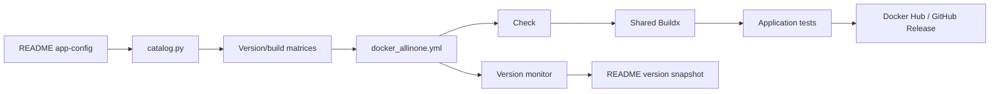

# docker-builder

Github Actions for Docker Image Building. / 使用 GitHub Actions 构建、检测与发布 Docker 镜像。

**Source of truth / 唯一配置源：** This README's `app-config` JSON. The application table is a view, **not** an independent configuration file. The one JSON document has separate `config` and `monitor` sections.

## Navigation / 目录

- [Applications / 应用清单](#applications--应用清单)
- [Workflow / 工作流](#workflow--工作流)
- [Maintenance / 配置维护](#maintenance--配置维护)
- [Machine-readable configuration / Actions 配置](#machine-readable-configuration--actions-配置)

## Applications / 应用清单

<!-- app-summary:start -->
**24 applications / 30 build targets** (generated from configuration below).

| Application | Registry repository | Tags | Platforms | Base image | Dockerfiles | Detected version | Probe status | Test |
|---|---|---|---|---|---|---|---|---|
| [adguardvpn-cli](application/adguardvpn-cli/) | `grinch27/adguardvpn-cli` | `nightly`, `beta`, `release` | `amd64`, `arm64` | `alpine:latest` | `Dockerfile` | `unknown` | `success` | <!-- app-test:adguardvpn-cli:start --><details><summary>Test</summary><pre><code>#!/bin/sh&#10;&#10;# Get current directory&#10;dir_current=$(dirname "$(readlink -f "$0")")&#10;echo "dir_current=${dir_current}"&#10;&#10;version=$(adguardvpn-cli --version)&#10;remove_prefix="AdGuard VPN CLI v"&#10;version=${version##*$remove_prefix}&#10;echo "version=${version}"&#10;</code></pre></details><!-- app-test:adguardvpn-cli:end --> |
| [aria2](application/aria2/) | `grinch27/aria2` | `latest` | `amd64`, `arm64` | `alpine:latest` | `Dockerfile` | `1.37.0` | `success` | <!-- app-test:aria2:start --><details><summary>Test</summary><pre><code>#!/bin/sh&#10;set -eu&#10;version=$(aria2c --version &#124; awk '/^aria2 version / {print $3; exit}')&#10;if [ -z "$version" ]; then echo "Unable to determine aria2 version" &gt;&amp;2; exit 1; fi&#10;case "$version" in *[![:print:]]*) echo "Invalid image version" &gt;&amp;2; exit 1;; esac&#10;printf 'version=%s\n' "$version"&#10;</code></pre></details><!-- app-test:aria2:end --> |
| [baidunetdisk](application/baidunetdisk/) | `grinch27/baidunetdisk` | `dev` | `amd64`, `arm64` | `debian:stable-slim` | `Dockerfile` | `4.17.7` | `success` | <!-- app-test:baidunetdisk:start --><details><summary>Test</summary><pre><code>#!/bin/sh&#10;&#10;# Get current directory&#10;dir_current=$(dirname "$(readlink -f "$0")")&#10;echo "dir_current=${dir_current}"&#10;&#10;# version=$(warp-cli --version)&#10;# remove_prefix="warp-cli "&#10;# version=${version##*$remove_prefix}&#10;# echo "version=${version}"&#10;sleep 10&#10;</code></pre></details><!-- app-test:baidunetdisk:end --> |
| [cloudflare-warp](application/cloudflare-warp/) | `grinch27/cloudflare-warp` | `latest` | `amd64`, `arm64` | `ubuntu:devel` | `Dockerfile` | `unknown` | `success` | <!-- app-test:cloudflare-warp:start --><details><summary>Test</summary><pre><code>#!/bin/sh&#10;&#10;# Get current directory&#10;dir_current=$(dirname "$(readlink -f "$0")")&#10;echo "dir_current=${dir_current}"&#10;&#10;version=$(warp-cli --version)&#10;remove_prefix="warp-cli "&#10;version=${version##*$remove_prefix}&#10;echo "version=${version}"&#10;&#10;# (base) user@user:~$ warp-cli&#10;# CLI to the WARP service daemon&#10;&#10;# Usage: warp-cli [OPTIONS] &lt;COMMAND&gt;&#10;&#10;# Commands:&#10;#   connect               Maintain a connection whenever possible&#10;#   debug                 Debugging commands&#10;#   disconnect            Disconnect the client&#10;#   dns                   Configure DNS settings&#10;#   environment           Configure the WARP Client's compliance environment&#10;#   mdm                   MDM configs&#10;#   mode                  Set the client's general operating mode&#10;#   override              Allow temporary overrides of administrative settings&#10;#   proxy                 Configure proxy mode settings&#10;#   registration          Registration settings&#10;#   connector             Register a WARP Connector&#10;#   settings              Show or alter general application settings&#10;#   status                Return the current connection status&#10;#   target                Manage targets&#10;#   trusted               Configure trusted networks where the client will be automatically disabled (Consumer only)&#10;#   tunnel                Configure tunnel settings&#10;#   vnet                  Get or specify connected virtual network&#10;#   generate-completions  Generate completions for a given shell and print to stdout&#10;#   stats                 Display statistics for Cloudflare WARP&#10;#   certs                 Print all account certificates installed on the device to stdout&#10;#   help                  Print this message or the help of the given subcommand(s)&#10;&#10;# Options:&#10;#   -l, --listen       Listen for status changes and DNS logs (if enabled)&#10;#       --accept-tos   Accept the Terms of Service agreement&#10;#   -v, --verbose...   Enable verbose output. Multiple "v"s adds more verbosity&#10;#   -j, --json         Pretty print output as json&#10;#       --no-paginate  Disable automatic pagination&#10;#       --no-ansi      Disable ANSI characters in standard outputs&#10;#   -h, --help         Print help (see more with '--help')&#10;#   -V, --version      Print version&#10;</code></pre></details><!-- app-test:cloudflare-warp:end --> |
| [curl](application/curl/) | `grinch27/curl` | `latest` | `amd64`, `arm64` | `alpine:edge` | `Dockerfile` | `unknown` | `success` | <!-- app-test:curl:start --><details><summary>Test</summary><pre><code>#!/bin/sh&#10;set -eu&#10;version=$(curl --version &#124; awk 'NR==1 {print $2; exit}')&#10;if [ -z "$version" ]; then echo "Unable to determine curl version" &gt;&amp;2; exit 1; fi&#10;case "$version" in *[![:print:]]*) echo "Invalid image version" &gt;&amp;2; exit 1;; esac&#10;printf 'version=%s\n' "$version"&#10;</code></pre></details><!-- app-test:curl:end --> |
| [dnscrypt-proxy](application/dnscrypt-proxy/) | `grinch27/dnscrypt-proxy` | `latest` | `amd64`, `arm64` | `alpine:edge` | `Dockerfile` | `2.1.18` | `success` | <!-- app-test:dnscrypt-proxy:start --><details><summary>Test</summary><pre><code>#!/bin/sh&#10;set -eu&#10;version=$(dnscrypt-proxy -version &#124; awk 'NR==1 {print; exit}')&#10;if [ -z "$version" ]; then echo "Unable to determine dnscrypt-proxy version" &gt;&amp;2; exit 1; fi&#10;case "$version" in *[![:print:]]*) echo "Invalid image version" &gt;&amp;2; exit 1;; esac&#10;printf 'version=%s\n' "$version"&#10;</code></pre></details><!-- app-test:dnscrypt-proxy:end --> |
| [doh-nosni](application/doh-nosni/) | `grinch27/doh-nosni` | `latest` | `amd64`, `arm64` | `debian:sid-slim` | `Dockerfile` | `unknown` | `success` | <!-- app-test:doh-nosni:start --><details><summary>Test</summary><pre><code>#!/bin/sh&#10;set -eu&#10;version=$(dnscrypt-proxy -version &#124; awk 'NR==1 {print; exit}')&#10;if [ -z "$version" ]; then echo "Unable to determine doh-nosni version" &gt;&amp;2; exit 1; fi&#10;case "$version" in *[![:print:]]*) echo "Invalid image version" &gt;&amp;2; exit 1;; esac&#10;printf 'version=%s\n' "$version"&#10;</code></pre></details><!-- app-test:doh-nosni:end --> |
| [expressvpn](application/expressvpn/) | `grinch27/expressvpn` | `latest` | `amd64`, `arm64`, `386`, `arm/v7` | `debian:stable-slim` | `Dockerfile` | `unknown` | `success` | <!-- app-test:expressvpn:start --><details><summary>Test</summary><pre><code>#!/bin/sh&#10;&#10;# Get current directory&#10;dir_current=$(dirname "$(readlink -f "$0")")&#10;echo "dir_current=${dir_current}"&#10;&#10;expressvpn --version&#10;&#10;version=$(expressvpn --version)&#10;remove_prefix="expressvpn version "&#10;remove_suffix=" ("&#10;version=${version##*$remove_prefix}&#10;version=${version%%$remove_suffix*}&#10;echo "version=${version}"&#10;</code></pre></details><!-- app-test:expressvpn:end --> |
| [ffmpeg](application/ffmpeg/) | `grinch27/ffmpeg` | `latest` | `amd64` | `ubuntu:devel` | `Dockerfile` | `unknown` | `meta_app_missing` | <!-- app-test:ffmpeg:start --><details><summary>Test</summary><pre><code>#!/bin/sh&#10;&#10;# Get current directory&#10;dir_current=$(dirname "$(readlink -f "$0")")&#10;echo "dir_current=${dir_current}"&#10;&#10;apt list --installed&#10;dpkg-query -Wf '${Installed-Size}\t${Package}\n' &#124; sort -n&#10;&#10;# dpkg -L app&#10;&#10;# version=$(app --version)&#10;# remove_prefix="app "&#10;# version=${version##*$remove_prefix}&#10;# echo "version=${version}"&#10;</code></pre></details><!-- app-test:ffmpeg:end --> |
| [nordvpn](application/nordvpn/) | `grinch27/nordvpn` | `latest` | `amd64`, `arm64` | `debian:stable-slim` | `Dockerfile` | `5.4.1` | `success` | <!-- app-test:nordvpn:start --><details><summary>Test</summary><pre><code>#!/bin/sh&#10;&#10;# Get current directory&#10;dir_current=$(dirname "$(readlink -f "$0")")&#10;echo "dir_current=${dir_current}"&#10;&#10;version=$(nordvpn --version)&#10;remove_prefix="NordVPN Version "&#10;version=${version##*$remove_prefix}&#10;echo "version=${version}"&#10;</code></pre></details><!-- app-test:nordvpn:end --> |
| [novnc](application/novnc/) | `grinch27/novnc` | `latest` | `amd64`, `arm64` | `debian:stable-slim` | `Dockerfile` | `1.7.0` | `success` | <!-- app-test:novnc:start --><details><summary>Test</summary><pre><code>#!/bin/sh&#10;&#10;# Get current directory&#10;dir_current=$(dirname "$(readlink -f "$0")")&#10;echo "dir_current=${dir_current}"&#10;&#10;# version=$(warp-cli --version)&#10;# remove_prefix="warp-cli "&#10;# version=${version##*$remove_prefix}&#10;# echo "version=${version}"&#10;# sleep 10&#10;</code></pre></details><!-- app-test:novnc:end --> |
| [novnc_alpine](application/novnc_alpine/) | `grinch27/novnc` | `latest` | `amd64`, `arm64` | `alpine:latest` | `Dockerfile` | `unknown` | `success` | <!-- app-test:novnc_alpine:start --><details><summary>Test</summary><pre><code>#!/bin/sh&#10;&#10;# Get current directory&#10;dir_current=$(dirname "$(readlink -f "$0")")&#10;echo "dir_current=${dir_current}"&#10;&#10;version=$(awk -F: '&#10;    $1 == "P" {package = $2}&#10;    package == "novnc" &amp;&amp; $1 == "V" {print $2; exit}&#10;    $0 == "" {package = ""}&#10;' /lib/apk/db/installed)&#10;if [ -z "${version}" ]; then&#10;    echo "Unable to determine the installed noVNC package version" &gt;&amp;2&#10;    exit 1&#10;fi&#10;echo "version=${version}"&#10;</code></pre></details><!-- app-test:novnc_alpine:end --> |
| [openwrt](application/openwrt/) | `grinch27/openwrt` | `main` | `amd64` | `ubuntu:devel` | `Dockerfile` | `unknown` | `success` | <!-- app-test:openwrt:start --><details><summary>Test</summary><pre><code>#!/bin/sh&#10;&#10;# Get current directory&#10;dir_current=$(dirname "$(readlink -f "$0")")&#10;echo "dir_current=${dir_current}"&#10;&#10;if [ ! -r /etc/openwrt_release ]; then&#10;    echo "Missing OpenWrt release metadata" &gt;&amp;2&#10;    exit 1&#10;fi&#10;&#10;# shellcheck disable=SC1091&#10;. /etc/openwrt_release&#10;if [ -z "${DISTRIB_RELEASE:-}" ] &#124;&#124; [ -z "${DISTRIB_REVISION:-}" ]; then&#10;    echo "Incomplete OpenWrt release metadata" &gt;&amp;2&#10;    exit 1&#10;fi&#10;echo "version=${DISTRIB_RELEASE}-${DISTRIB_REVISION}"&#10;</code></pre></details><!-- app-test:openwrt:end --> |
| [privoxy](application/privoxy/) | `grinch27/privoxy` | `latest` | `amd64`, `arm64` | `alpine:latest` | `Dockerfile` | `4.0.0` | `success` | <!-- app-test:privoxy:start --><details><summary>Test</summary><pre><code>#!/bin/sh&#10;set -eu&#10;version=$(privoxy --version &#124; awk '/^Privoxy version / {print $3; exit}')&#10;if [ -z "$version" ]; then echo "Unable to determine privoxy version" &gt;&amp;2; exit 1; fi&#10;case "$version" in *[![:print:]]*) echo "Invalid image version" &gt;&amp;2; exit 1;; esac&#10;printf 'version=%s\n' "$version"&#10;</code></pre></details><!-- app-test:privoxy:end --> |
| [protonvpn](application/protonvpn/) | `grinch27/protonvpn` | `latest` | `amd64` | `debian:stable-slim` | `Dockerfile` | `1.0.8` | `success` | <!-- app-test:protonvpn:start --><details><summary>Test</summary><pre><code>#!/bin/sh&#10;&#10;# Get current directory&#10;dir_current=$(dirname "$(readlink -f "$0")")&#10;echo "dir_current=${dir_current}"&#10;&#10;apt list --installed&#10;dpkg-query -Wf '${Installed-Size}\t${Package}\n' &#124; sort -n&#10;&#10;# dpkg -L app&#10;&#10;# version=$(app --version)&#10;# remove_prefix="app "&#10;# version=${version##*$remove_prefix}&#10;# echo "version=${version}"&#10;</code></pre></details><!-- app-test:protonvpn:end --> |
| [runner](application/runner/) | `grinch27/runner` | `dev`, `slim`, `actions`, `actions-slim` | `amd64` | `debian:testing-slim` | `Dockerfile`, `slim.Dockerfile`, `actions.Dockerfile`, `actions-slim.Dockerfile` | `unknown` | `success` | <!-- app-test:runner:start --><details><summary>Test</summary><pre><code>#!/bin/sh&#10;&#10;# Get current directory&#10;dir_current=$(dirname "$(readlink -f "$0")")&#10;echo "dir_current=${dir_current}"&#10;&#10;apt list --installed&#10;dpkg-query -Wf '${Installed-Size}\t${Package}\n' &#124; sort -n&#10;&#10;if [ -x /actions-runner/bin/Runner.Listener ]; then&#10;    version=$(/actions-runner/bin/Runner.Listener --version 2&gt;/dev/null &#124; awk 'NF {value=$NF} END {print value}')&#10;else&#10;    os_version=$(sed -n 's/^VERSION_CODENAME=//p' /etc/os-release &#124; tr -d '"')&#10;    gcc_version=$(gcc -dumpfullversion -dumpversion)&#10;    version="debian-${os_version}-gcc-${gcc_version}"&#10;    if command -v clang &gt;/dev/null 2&gt;&amp;1; then&#10;        clang_version=$(clang --version &#124; awk 'NR == 1 {print $4}')&#10;        version="${version}-clang-${clang_version}"&#10;    fi&#10;    if command -v cmake &gt;/dev/null 2&gt;&amp;1; then&#10;        cmake_version=$(cmake --version &#124; awk 'NR == 1 {print $3}')&#10;        version="${version}-cmake-${cmake_version}"&#10;    fi&#10;fi&#10;&#10;if [ -z "${version}" ]; then&#10;    echo "Unable to determine runner version identity" &gt;&amp;2&#10;    exit 1&#10;fi&#10;echo "version=${version}"&#10;</code></pre></details><!-- app-test:runner:end --> |
| [samba](application/samba/) | `grinch27/samba` | `latest`, `alpine` | `amd64`, `arm64` | `debian:testing-slim` + `alpine: alpine:latest` | `Dockerfile`, `alpine.Dockerfile` | `4.25.0` | `success` | <!-- app-test:samba:start --><details><summary>Test</summary><pre><code>#!/bin/sh&#10;&#10;# Get current directory&#10;dir_current=$(dirname "$(readlink -f "$0")")&#10;echo "dir_current=${dir_current}"&#10;&#10;# Version 4.20.6&#10;# 4.21.3-Debian-4.21.3+dfsg-6+b1&#10;version=$(smbd --version)&#10;# version=$(echo "$version" &#124; awk '/Version/ {print $2}')&#10;# echo "version=${version}"&#10;&#10;remove_prefix="Version "&#10;remove_suffix="-Debian"&#10;version=${version##*$remove_prefix}&#10;version=${version%%$remove_suffix*}&#10;echo "version=${version}"&#10;</code></pre></details><!-- app-test:samba:end --> |
| [sdnext](application/sdnext/) | `grinch27/sdnext` | `latest` | `amd64` | `rocm/dev-ubuntu-24.04` | `Dockerfile` | `7.2` | `success` | <!-- app-test:sdnext:start --><details><summary>Test</summary><pre><code>#!/bin/sh&#10;&#10;set -eu&#10;&#10;# Get current directory&#10;dir_current=$(dirname "$(readlink -f "$0")")&#10;echo "dir_current=${dir_current}"&#10;&#10;if [ -x /mnt/python/venv/bin/python ]; then&#10;  py_cmd=/mnt/python/venv/bin/python&#10;elif [ -x /opt/venv/bin/python ]; then&#10;  py_cmd=/opt/venv/bin/python&#10;else&#10;  py_cmd=python3&#10;fi&#10;&#10;${py_cmd} --version &#124;&#124; true&#10;&#10;${py_cmd} - &lt;&lt;'PY'&#10;try:&#10;    import torch&#10;    print(f"torch={torch.__version__}")&#10;    print(f"hip={getattr(torch.version, 'hip', 'unknown')}")&#10;    print(f"cuda_available={torch.cuda.is_available()}")&#10;except Exception as exc:&#10;    print(f"torch=unavailable ({exc})")&#10;PY&#10;&#10;if [ -x /opt/rocm/bin/rocminfo ]; then&#10;  /opt/rocm/bin/rocminfo &gt;/dev/null 2&gt;&amp;1 &#124;&#124; true&#10;fi&#10;&#10;if [ -d /app/.git ]; then&#10;  commit_id=$(git -C /app rev-parse --short HEAD &#124;&#124; true)&#10;  echo "commit=${commit_id}"&#10;fi&#10;&#10;version=""&#10;if [ -f /opt/rocm/.info/version ]; then&#10;  version=$(awk 'NR==1 {print $1}' /opt/rocm/.info/version)&#10;elif [ -f /opt/rocm/.info/version-utils ]; then&#10;  version=$(awk 'NR==1 {print $1}' /opt/rocm/.info/version-utils)&#10;fi&#10;version=$(echo "${version:-7.2}" &#124; sed -E 's/^([0-9]+\.[0-9]+).*/\1/')&#10;&#10;echo "version=rocm${version}"&#10;</code></pre></details><!-- app-test:sdnext:end --> |
| [sdnext-dev](application/sdnext-dev/) | `grinch27/sdnext` | `dev` | `amd64` | `ubuntu:24.04` | `Dockerfile` | `7.11` | `success` | <!-- app-test:sdnext-dev:start --><details><summary>Test</summary><pre><code>#!/bin/sh&#10;&#10;set -eu&#10;&#10;# Get current directory&#10;dir_current=$(dirname "$(readlink -f "$0")")&#10;echo "dir_current=${dir_current}"&#10;&#10;if [ -x /mnt/python/venv/bin/python ]; then&#10;  py_cmd=/mnt/python/venv/bin/python&#10;elif [ -x /opt/venv/bin/python ]; then&#10;  py_cmd=/opt/venv/bin/python&#10;else&#10;  py_cmd=python3&#10;fi&#10;&#10;${py_cmd} --version &#124;&#124; true&#10;&#10;${py_cmd} - &lt;&lt;'PY'&#10;try:&#10;    import torch&#10;    print(f"torch={torch.__version__}")&#10;    print(f"hip={getattr(torch.version, 'hip', 'unknown')}")&#10;    print(f"cuda_available={torch.cuda.is_available()}")&#10;except Exception as exc:&#10;    print(f"torch=unavailable ({exc})")&#10;PY&#10;&#10;if [ -f /etc/therock-version ]; then&#10;  therock_version=$(awk 'NR==1 {print $1}' /etc/therock-version)&#10;  echo "therock=${therock_version}"&#10;fi&#10;&#10;if [ -x /opt/rocm/bin/rocminfo ]; then&#10;  /opt/rocm/bin/rocminfo &gt;/dev/null 2&gt;&amp;1 &#124;&#124; true&#10;fi&#10;&#10;if [ -d /app/.git ]; then&#10;  commit_id=$(git -C /app rev-parse --short HEAD &#124;&#124; true)&#10;  echo "commit=${commit_id}"&#10;fi&#10;&#10;version=""&#10;if [ -n "${ROCM_VERSION:-}" ]; then&#10;  version="${ROCM_VERSION}"&#10;elif [ -n "${THEROCK_VERSION:-}" ]; then&#10;  version="${THEROCK_VERSION}"&#10;elif [ -f /etc/therock-version ]; then&#10;  version=$(awk 'NR==1 {print $1}' /etc/therock-version)&#10;elif [ -f /opt/rocm/.info/version ]; then&#10;  version=$(awk 'NR==1 {print $1}' /opt/rocm/.info/version)&#10;elif [ -f /opt/rocm/.info/version-utils ]; then&#10;  version=$(awk 'NR==1 {print $1}' /opt/rocm/.info/version-utils)&#10;fi&#10;version=$(echo "${version:-7.11}" &#124; sed -E 's/^([0-9]+\.[0-9]+).*/\1/')&#10;&#10;echo "version=rocm${version}"</code></pre></details><!-- app-test:sdnext-dev:end --> |
| [squid](application/squid/) | `grinch27/squid` | `latest` | `amd64`, `arm64` | `alpine:latest` | `Dockerfile` | `7.6-VCS` | `success` | <!-- app-test:squid:start --><details><summary>Test</summary><pre><code>#!/bin/sh&#10;set -eu&#10;version=$(squid --version &#124; awk '/^Squid Cache: Version/ {print $4; exit}')&#10;if [ -z "$version" ]; then echo "Unable to determine squid version" &gt;&amp;2; exit 1; fi&#10;case "$version" in *[![:print:]]*) echo "Invalid image version" &gt;&amp;2; exit 1;; esac&#10;printf 'version=%s\n' "$version"&#10;</code></pre></details><!-- app-test:squid:end --> |
| [stable-diffusion-webui-amdgpu](application/stable-diffusion-webui-amdgpu/) | `grinch27/stable-diffusion-webui-amdgpu` | `latest` | `amd64` | `rocm/dev-ubuntu-24.04` | `Dockerfile` | `7.2` | `success` | <!-- app-test:stable-diffusion-webui-amdgpu:start --><details><summary>Test</summary><pre><code>#!/bin/sh&#10;&#10;set -eu&#10;&#10;# Get current directory&#10;dir_current=$(dirname "$(readlink -f "$0")")&#10;echo "dir_current=${dir_current}"&#10;&#10;if [ -x /opt/venv/bin/python ]; then&#10;	py_cmd=/opt/venv/bin/python&#10;else&#10;	py_cmd=python3&#10;fi&#10;&#10;${py_cmd} --version&#10;&#10;${py_cmd} - &lt;&lt;'PY'&#10;import torch&#10;print(f"torch={torch.__version__}")&#10;print(f"hip={getattr(torch.version, 'hip', 'unknown')}")&#10;print(f"cuda_available={torch.cuda.is_available()}")&#10;PY&#10;&#10;if [ -x /opt/rocm/bin/rocminfo ]; then&#10;	/opt/rocm/bin/rocminfo &gt;/dev/null 2&gt;&amp;1 &#124;&#124; true&#10;fi&#10;&#10;if [ -d /opt/stable-diffusion-webui/.git ]; then&#10;	commit_id=$(git -C /opt/stable-diffusion-webui rev-parse --short HEAD)&#10;	echo "commit=${commit_id}"&#10;fi&#10;&#10;version=$(${py_cmd} - &lt;&lt;'PY'&#10;import torch&#10;hip = getattr(torch.version, "hip", "unknown")&#10;if isinstance(hip, str) and hip and hip != "unknown":&#10;		parts = hip.split(".")&#10;		hip = ".".join(parts[:2])&#10;print(f"rocm{hip}-torch{torch.__version__}")&#10;PY&#10;)&#10;&#10;echo "version=${version}"&#10;</code></pre></details><!-- app-test:stable-diffusion-webui-amdgpu:end --> |
| [steamcmd](application/steamcmd/) | `grinch27/steamcmd` | `dev` | `amd64` | `debian:testing-slim` | `Dockerfile` | `unknown` | `success` | <!-- app-test:steamcmd:start --><details><summary>Test</summary><pre><code>#!/bin/sh&#10;&#10;# Get current directory&#10;dir_current=$(dirname "$(readlink -f "$0")")&#10;echo "dir_current=${dir_current}"&#10;&#10;# version=$(warp-cli --version)&#10;# remove_prefix="warp-cli "&#10;# version=${version##*$remove_prefix}&#10;# echo "version=${version}"&#10;&#10;apt list&#10;dpkg -L steamcmd&#10;# ls -lh /home/steam/&#10;steamcmd&#10;</code></pre></details><!-- app-test:steamcmd:end --> |
| [ttrss](application/ttrss/) | `grinch27/ttrss` | `latest` | `amd64`, `arm64` | `alpine:latest` | `Dockerfile` | `1113-5-g70e0357` | `success` | <!-- app-test:ttrss:start --><details><summary>Test</summary><pre><code>#!/bin/sh&#10;&#10;# Get current directory&#10;dir_current=$(dirname "$(readlink -f "$0")")&#10;echo "dir_current=${dir_current}"&#10;&#10;vlmcsd -V&#10;&#10;version=$(vlmcsd -V)&#10;remove_prefix="vlmcsd svn"&#10;remove_suffix=", built"&#10;version=${version##*$remove_prefix}&#10;version=${version%%$remove_suffix*}&#10;echo "version=${version}"&#10;</code></pre></details><!-- app-test:ttrss:end --> |
| [vlmcsd](application/vlmcsd/) | `grinch27/vlmcsd` | `latest` | `amd64`, `arm64`, `386` | `alpine:latest` | `Dockerfile` | `1113-5-g70e0357` | `success` | <!-- app-test:vlmcsd:start --><details><summary>Test</summary><pre><code>#!/bin/sh&#10;&#10;# Get current directory&#10;dir_current=$(dirname "$(readlink -f "$0")")&#10;echo "dir_current=${dir_current}"&#10;&#10;vlmcsd -V&#10;&#10;version=$(vlmcsd -V)&#10;remove_prefix="vlmcsd svn"&#10;remove_suffix=", built"&#10;version=${version##*$remove_prefix}&#10;version=${version%%$remove_suffix*}&#10;echo "version=${version}"&#10;</code></pre></details><!-- app-test:vlmcsd:end --> |
<!-- app-summary:end -->

> **Known conflict / 已知冲突：** `novnc` and `novnc_alpine` both use `grinch27/novnc:latest`. The two directories do not own independent output tags. No tags are changed by this documentation update.

## Workflow / 工作流



[Production workflow](.github/workflows/docker_allinone.yml) is the authoritative scheduled build/publish entry and now also routes **explicit manual Dev** selections to [reusable Dev execution](.github/workflows/docker_allinone_dev.yml). [Independent monitor](.github/workflows/monitor-images.yml), [non-publishing GPT smoke](.github/workflows/docker_allinone_gpt.yml), and [unified layer/version diagnostics](.github/workflows/diagnostics.yml) remain separate. Experimental Dev promotion retains its existing implementation until a live publishing-parity test is authorized. / 生产定时执行不进入 Dev 路由；诊断不会推送镜像。

## Maintenance / 配置维护

| Section | Maintainer | Actions behavior |
|---|---|---|
| `app-config` JSON | Manual review / `catalog.py set` | **Authoritative** app and target settings |
| `app-summary` | Derived from `app-config` and monitor versions | Only visible data table; never parsed as configuration |
| `monitor.records` (inside `app-config`) | Production monitor | Historical application observations for semantic change detection |

Common commands:

```bash
python3 scripts/ci/catalog.py validate
python3 scripts/ci/catalog.py summary --check
python3 -m unittest discover -s scripts/ci -p 'test_catalog.py' -v
python3 scripts/ci/catalog.py matrix --kind build
python3 scripts/ci/catalog.py get --app samba --tag alpine
python3 scripts/ci/catalog.py set --scope target --app samba --tag alpine --field base_image --value alpine:latest
```

Keep `config` manually reviewed and allow Actions to update only `monitor.records`. If you edit the canonical JSON manually, run `python3 scripts/ci/catalog.py summary --write` to refresh the visible table, then run `summary --check` and the unit tests. `catalog.py set` updates both JSON and the application table atomically. / 手动修改 JSON 后先同步应用表，再进行完整检查。

Documentation: [application layout](application/route.md), [workflow consolidation](docs/workflow-consolidation.md). [Markdown-only table feasibility lab / 纯表格方案隔离研究](docs/markdown-table-lab.md) is experimental and **not** used by production Actions.

## Machine-readable configuration / Actions 配置

<details>
<summary><strong>Show combined configuration and monitor JSON (schema v2) / 展开统一配置与监控 JSON</strong></summary>

**For Actions:** This single JSON block contains `config` (reviewed, authoritative application settings) and `monitor.records` (historical application-level probes, updated by Actions). Preserve its `app-config` markers and fenced JSON; Actions do not read the visible table. / 请保留 JSON 和标记；表格只是展示，不是运行时配置源。

<!-- app-config:start -->
```json
{
  "schema_version": 2,
  "config": {
    "schema_version": 1,
    "apps": {
      "adguardvpn-cli": {
        "repository": "grinch27/adguardvpn-cli",
        "base_image": "alpine:latest",
        "platforms": [
          "linux/amd64",
          "linux/arm64"
        ],
        "tag_policy": "keep",
        "targets": [
          {
            "tag": "nightly",
            "dockerfile": "Dockerfile",
            "build_arg": "update_channel=nightly"
          },
          {
            "tag": "beta",
            "dockerfile": "Dockerfile",
            "build_arg": "update_channel=beta"
          },
          {
            "tag": "release",
            "dockerfile": "Dockerfile",
            "build_arg": "update_channel=release"
          }
        ]
      },
      "aria2": {
        "repository": "grinch27/aria2",
        "base_image": "alpine:latest",
        "platforms": [
          "linux/amd64",
          "linux/arm64"
        ],
        "tag_policy": "strip_channel",
        "targets": [
          {
            "tag": "latest",
            "dockerfile": "Dockerfile"
          }
        ]
      },
      "baidunetdisk": {
        "repository": "grinch27/baidunetdisk",
        "base_image": "debian:stable-slim",
        "platforms": [
          "linux/amd64",
          "linux/arm64"
        ],
        "tag_policy": "strip_channel",
        "targets": [
          {
            "tag": "dev",
            "dockerfile": "Dockerfile"
          }
        ]
      },
      "cloudflare-warp": {
        "repository": "grinch27/cloudflare-warp",
        "base_image": "ubuntu:devel",
        "platforms": [
          "linux/amd64",
          "linux/arm64"
        ],
        "tag_policy": "strip_channel",
        "targets": [
          {
            "tag": "latest",
            "dockerfile": "Dockerfile"
          }
        ]
      },
      "curl": {
        "repository": "grinch27/curl",
        "base_image": "alpine:edge",
        "platforms": [
          "linux/amd64",
          "linux/arm64"
        ],
        "tag_policy": "keep",
        "targets": [
          {
            "tag": "latest",
            "dockerfile": "Dockerfile"
          }
        ]
      },
      "dnscrypt-proxy": {
        "repository": "grinch27/dnscrypt-proxy",
        "base_image": "alpine:edge",
        "platforms": [
          "linux/amd64",
          "linux/arm64"
        ],
        "tag_policy": "strip_channel",
        "targets": [
          {
            "tag": "latest",
            "dockerfile": "Dockerfile"
          }
        ]
      },
      "doh-nosni": {
        "repository": "grinch27/doh-nosni",
        "base_image": "debian:sid-slim",
        "platforms": [
          "linux/amd64",
          "linux/arm64"
        ],
        "tag_policy": "strip_channel",
        "targets": [
          {
            "tag": "latest",
            "dockerfile": "Dockerfile"
          }
        ]
      },
      "expressvpn": {
        "repository": "grinch27/expressvpn",
        "base_image": "debian:stable-slim",
        "platforms": [
          "linux/amd64",
          "linux/arm64",
          "linux/386",
          "linux/arm/v7"
        ],
        "tag_policy": "strip_channel",
        "targets": [
          {
            "tag": "latest",
            "dockerfile": "Dockerfile"
          }
        ]
      },
      "ffmpeg": {
        "repository": "grinch27/ffmpeg",
        "base_image": "ubuntu:devel",
        "platforms": [
          "linux/amd64"
        ],
        "tag_policy": "none",
        "targets": [
          {
            "tag": "latest",
            "dockerfile": "Dockerfile"
          }
        ]
      },
      "nordvpn": {
        "repository": "grinch27/nordvpn",
        "base_image": "debian:stable-slim",
        "platforms": [
          "linux/amd64",
          "linux/arm64"
        ],
        "tag_policy": "strip_channel",
        "targets": [
          {
            "tag": "latest",
            "dockerfile": "Dockerfile"
          }
        ]
      },
      "novnc": {
        "repository": "grinch27/novnc",
        "base_image": "debian:stable-slim",
        "platforms": [
          "linux/amd64",
          "linux/arm64"
        ],
        "tag_policy": "strip_channel",
        "targets": [
          {
            "tag": "latest",
            "dockerfile": "Dockerfile"
          }
        ]
      },
      "novnc_alpine": {
        "repository": "grinch27/novnc",
        "base_image": "alpine:latest",
        "platforms": [
          "linux/amd64",
          "linux/arm64"
        ],
        "tag_policy": "none",
        "targets": [
          {
            "tag": "latest",
            "dockerfile": "Dockerfile"
          }
        ]
      },
      "openwrt": {
        "repository": "grinch27/openwrt",
        "base_image": "ubuntu:devel",
        "platforms": [
          "linux/amd64"
        ],
        "tag_policy": "none",
        "targets": [
          {
            "tag": "main",
            "dockerfile": "Dockerfile"
          }
        ]
      },
      "privoxy": {
        "repository": "grinch27/privoxy",
        "base_image": "alpine:latest",
        "platforms": [
          "linux/amd64",
          "linux/arm64"
        ],
        "tag_policy": "strip_channel",
        "targets": [
          {
            "tag": "latest",
            "dockerfile": "Dockerfile"
          }
        ]
      },
      "protonvpn": {
        "repository": "grinch27/protonvpn",
        "base_image": "debian:stable-slim",
        "platforms": [
          "linux/amd64"
        ],
        "tag_policy": "none",
        "targets": [
          {
            "tag": "latest",
            "dockerfile": "Dockerfile"
          }
        ]
      },
      "runner": {
        "repository": "grinch27/runner",
        "base_image": "debian:testing-slim",
        "platforms": [
          "linux/amd64"
        ],
        "tag_policy": "none",
        "targets": [
          {
            "tag": "dev",
            "dockerfile": "Dockerfile"
          },
          {
            "tag": "slim",
            "dockerfile": "slim.Dockerfile"
          },
          {
            "tag": "actions",
            "dockerfile": "actions.Dockerfile"
          },
          {
            "tag": "actions-slim",
            "dockerfile": "actions-slim.Dockerfile"
          }
        ]
      },
      "samba": {
        "repository": "grinch27/samba",
        "base_image": "debian:testing-slim",
        "platforms": [
          "linux/amd64",
          "linux/arm64"
        ],
        "tag_policy": "strip_channel",
        "targets": [
          {
            "tag": "latest",
            "dockerfile": "Dockerfile"
          },
          {
            "tag": "alpine",
            "dockerfile": "alpine.Dockerfile",
            "base_image": "alpine:latest"
          }
        ]
      },
      "sdnext": {
        "repository": "grinch27/sdnext",
        "base_image": "rocm/dev-ubuntu-24.04",
        "platforms": [
          "linux/amd64"
        ],
        "tag_policy": "strip_channel_and_spaces",
        "targets": [
          {
            "tag": "latest",
            "dockerfile": "Dockerfile"
          }
        ]
      },
      "sdnext-dev": {
        "repository": "grinch27/sdnext",
        "base_image": "ubuntu:24.04",
        "platforms": [
          "linux/amd64"
        ],
        "tag_policy": "strip_channel_and_spaces",
        "targets": [
          {
            "tag": "dev",
            "dockerfile": "Dockerfile",
            "build_arg": "therock_version=7.11.0,therock_release_type=stable,therock_amdgpu_family=gfx110X-all"
          }
        ]
      },
      "squid": {
        "repository": "grinch27/squid",
        "base_image": "alpine:latest",
        "platforms": [
          "linux/amd64",
          "linux/arm64"
        ],
        "tag_policy": "strip_channel",
        "targets": [
          {
            "tag": "latest",
            "dockerfile": "Dockerfile"
          }
        ]
      },
      "stable-diffusion-webui-amdgpu": {
        "repository": "grinch27/stable-diffusion-webui-amdgpu",
        "base_image": "rocm/dev-ubuntu-24.04",
        "platforms": [
          "linux/amd64"
        ],
        "tag_policy": "strip_channel_and_spaces",
        "targets": [
          {
            "tag": "latest",
            "dockerfile": "Dockerfile"
          }
        ]
      },
      "steamcmd": {
        "repository": "grinch27/steamcmd",
        "base_image": "debian:testing-slim",
        "platforms": [
          "linux/amd64"
        ],
        "tag_policy": "none",
        "targets": [
          {
            "tag": "dev",
            "dockerfile": "Dockerfile"
          }
        ]
      },
      "ttrss": {
        "repository": "grinch27/ttrss",
        "base_image": "alpine:latest",
        "platforms": [
          "linux/amd64",
          "linux/arm64"
        ],
        "tag_policy": "strip_channel",
        "targets": [
          {
            "tag": "latest",
            "dockerfile": "Dockerfile"
          }
        ]
      },
      "vlmcsd": {
        "repository": "grinch27/vlmcsd",
        "base_image": "alpine:latest",
        "platforms": [
          "linux/amd64",
          "linux/arm64",
          "linux/386"
        ],
        "tag_policy": "strip_channel",
        "targets": [
          {
            "tag": "latest",
            "dockerfile": "Dockerfile"
          }
        ]
      }
    }
  },
  "monitor": {
    "records": [
      {
        "app_branch": "adguardvpn-cli",
        "arch_branch": "linux/amd64,linux/arm64",
        "base_image": "alpine:latest",
        "platform_used": "linux/amd64",
        "repo_dockerhub": "grinch27/adguardvpn-cli",
        "status": "success",
        "tag_repo": "latest",
        "version": "unknown"
      },
      {
        "app_branch": "aria2",
        "arch_branch": "linux/amd64,linux/arm64",
        "base_image": "alpine:latest",
        "platform_used": "linux/amd64",
        "repo_dockerhub": "grinch27/aria2",
        "status": "success",
        "tag_repo": "latest",
        "version": "1.37.0"
      },
      {
        "app_branch": "baidunetdisk",
        "arch_branch": "linux/amd64,linux/arm64",
        "base_image": "debian:stable-slim",
        "platform_used": "linux/amd64",
        "repo_dockerhub": "grinch27/baidunetdisk",
        "status": "success",
        "tag_repo": "latest",
        "version": "4.17.7"
      },
      {
        "app_branch": "cloudflare-warp",
        "arch_branch": "linux/amd64,linux/arm64",
        "base_image": "ubuntu:devel",
        "platform_used": "linux/amd64",
        "repo_dockerhub": "grinch27/cloudflare-warp",
        "status": "success",
        "tag_repo": "latest",
        "version": "unknown"
      },
      {
        "app_branch": "curl",
        "arch_branch": "linux/amd64,linux/arm64",
        "base_image": "alpine:edge",
        "platform_used": "linux/amd64",
        "repo_dockerhub": "grinch27/curl",
        "status": "success",
        "tag_repo": "latest",
        "version": "unknown"
      },
      {
        "app_branch": "dnscrypt-proxy",
        "arch_branch": "linux/amd64,linux/arm64",
        "base_image": "alpine:edge",
        "platform_used": "linux/amd64",
        "repo_dockerhub": "grinch27/dnscrypt-proxy",
        "status": "success",
        "tag_repo": "latest",
        "version": "2.1.18"
      },
      {
        "app_branch": "doh-nosni",
        "arch_branch": "linux/amd64,linux/arm64",
        "base_image": "debian:sid-slim",
        "platform_used": "linux/amd64",
        "repo_dockerhub": "grinch27/doh-nosni",
        "status": "success",
        "tag_repo": "latest",
        "version": "unknown"
      },
      {
        "app_branch": "expressvpn",
        "arch_branch": "linux/amd64,linux/arm64,linux/386,linux/arm/v7",
        "base_image": "debian:stable-slim",
        "platform_used": "linux/amd64",
        "repo_dockerhub": "grinch27/expressvpn",
        "status": "success",
        "tag_repo": "latest",
        "version": "unknown"
      },
      {
        "app_branch": "ffmpeg",
        "arch_branch": "linux/amd64",
        "base_image": "ubuntu:devel",
        "platform_used": "linux/amd64",
        "repo_dockerhub": "grinch27/ffmpeg",
        "status": "meta_app_missing",
        "tag_repo": "latest",
        "version": "unknown"
      },
      {
        "app_branch": "nordvpn",
        "arch_branch": "linux/amd64,linux/arm64",
        "base_image": "debian:stable-slim",
        "platform_used": "linux/amd64",
        "repo_dockerhub": "grinch27/nordvpn",
        "status": "success",
        "tag_repo": "latest",
        "version": "5.4.1"
      },
      {
        "app_branch": "novnc",
        "arch_branch": "linux/amd64,linux/arm64",
        "base_image": "debian:stable-slim",
        "platform_used": "linux/amd64",
        "repo_dockerhub": "grinch27/novnc",
        "status": "success",
        "tag_repo": "latest",
        "version": "1.7.0"
      },
      {
        "app_branch": "novnc_alpine",
        "arch_branch": "linux/amd64,linux/arm64",
        "base_image": "alpine:latest",
        "platform_used": "linux/amd64",
        "repo_dockerhub": "grinch27/novnc",
        "status": "success",
        "tag_repo": "latest",
        "version": "unknown"
      },
      {
        "app_branch": "openwrt",
        "arch_branch": "linux/amd64",
        "base_image": "ubuntu:devel",
        "platform_used": "linux/amd64",
        "repo_dockerhub": "grinch27/openwrt",
        "status": "success",
        "tag_repo": "latest",
        "version": "unknown"
      },
      {
        "app_branch": "privoxy",
        "arch_branch": "linux/amd64,linux/arm64",
        "base_image": "alpine:latest",
        "platform_used": "linux/amd64",
        "repo_dockerhub": "grinch27/privoxy",
        "status": "success",
        "tag_repo": "latest",
        "version": "4.0.0"
      },
      {
        "app_branch": "protonvpn",
        "arch_branch": "linux/amd64",
        "base_image": "debian:stable-slim",
        "platform_used": "linux/amd64",
        "repo_dockerhub": "grinch27/protonvpn",
        "status": "success",
        "tag_repo": "latest",
        "version": "1.0.8"
      },
      {
        "app_branch": "runner",
        "arch_branch": "linux/amd64",
        "base_image": "debian:testing-slim",
        "platform_used": "linux/amd64",
        "repo_dockerhub": "grinch27/runner",
        "status": "success",
        "tag_repo": "latest",
        "version": "unknown"
      },
      {
        "app_branch": "samba",
        "arch_branch": "linux/amd64,linux/arm64",
        "base_image": "debian:testing-slim",
        "platform_used": "linux/amd64",
        "repo_dockerhub": "grinch27/samba",
        "status": "success",
        "tag_repo": "latest",
        "version": "4.25.0"
      },
      {
        "app_branch": "sdnext",
        "arch_branch": "linux/amd64",
        "base_image": "rocm/dev-ubuntu-24.04",
        "platform_used": "linux/amd64",
        "repo_dockerhub": "grinch27/sdnext",
        "status": "success",
        "tag_repo": "latest",
        "version": "7.2"
      },
      {
        "app_branch": "sdnext-dev",
        "arch_branch": "linux/amd64",
        "base_image": "ubuntu:24.04",
        "platform_used": "linux/amd64",
        "repo_dockerhub": "grinch27/sdnext",
        "status": "success",
        "tag_repo": "latest",
        "version": "7.11"
      },
      {
        "app_branch": "squid",
        "arch_branch": "linux/amd64,linux/arm64",
        "base_image": "alpine:latest",
        "platform_used": "linux/amd64",
        "repo_dockerhub": "grinch27/squid",
        "status": "success",
        "tag_repo": "latest",
        "version": "7.6-VCS"
      },
      {
        "app_branch": "stable-diffusion-webui-amdgpu",
        "arch_branch": "linux/amd64",
        "base_image": "rocm/dev-ubuntu-24.04",
        "platform_used": "linux/amd64",
        "repo_dockerhub": "grinch27/stable-diffusion-webui-amdgpu",
        "status": "success",
        "tag_repo": "latest",
        "version": "7.2"
      },
      {
        "app_branch": "steamcmd",
        "arch_branch": "linux/amd64",
        "base_image": "debian:testing-slim",
        "platform_used": "linux/amd64",
        "repo_dockerhub": "grinch27/steamcmd",
        "status": "success",
        "tag_repo": "latest",
        "version": "unknown"
      },
      {
        "app_branch": "ttrss",
        "arch_branch": "linux/amd64,linux/arm64",
        "base_image": "alpine:latest",
        "platform_used": "linux/amd64",
        "repo_dockerhub": "grinch27/ttrss",
        "status": "success",
        "tag_repo": "latest",
        "version": "1113-5-g70e0357"
      },
      {
        "app_branch": "vlmcsd",
        "arch_branch": "linux/amd64,linux/arm64,linux/386",
        "base_image": "alpine:latest",
        "platform_used": "linux/amd64",
        "repo_dockerhub": "grinch27/vlmcsd",
        "status": "success",
        "tag_repo": "latest",
        "version": "1113-5-g70e0357"
      }
    ]
  }
}
```
<!-- app-config:end -->

</details>

## Version snapshot / 监控数据快照

The previous application-level observations are retained in the `monitor.records` section of the single configuration JSON above. **A successful version probe does not imply that an image was published.**
